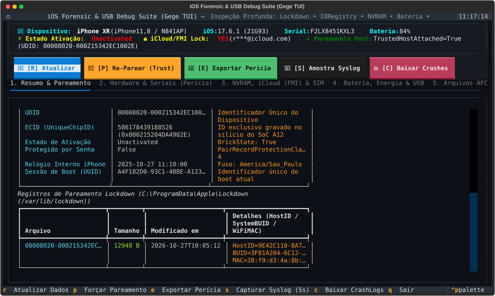
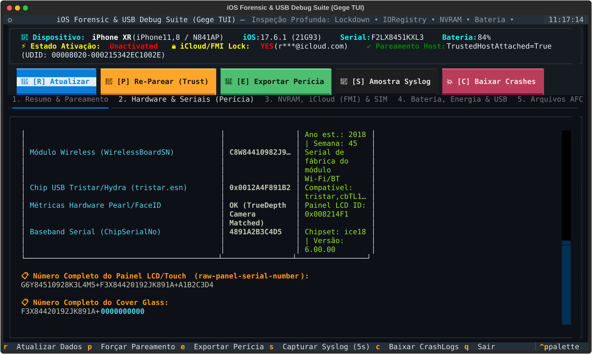
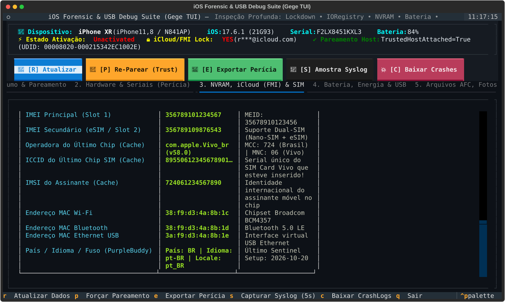
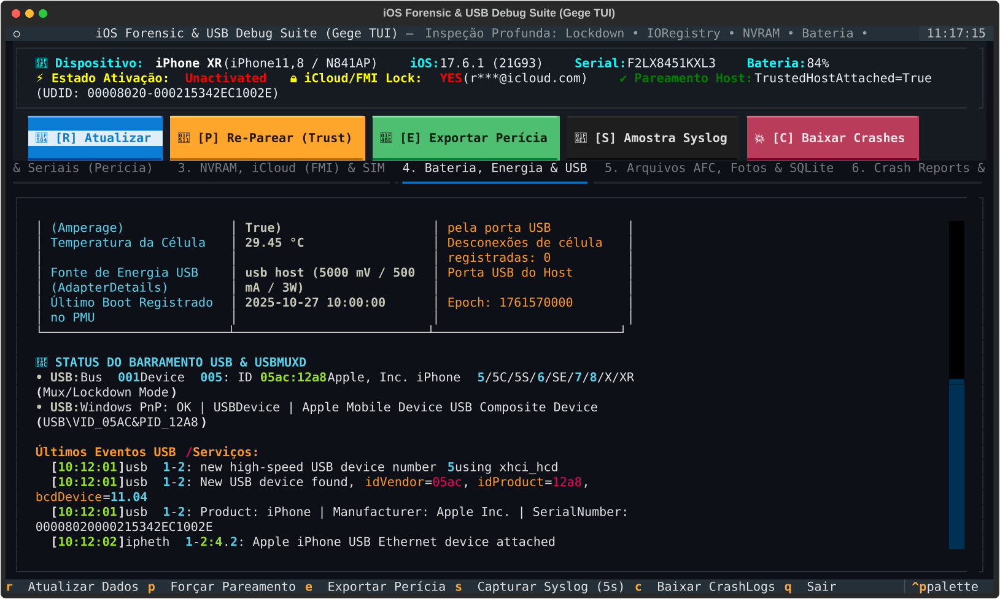
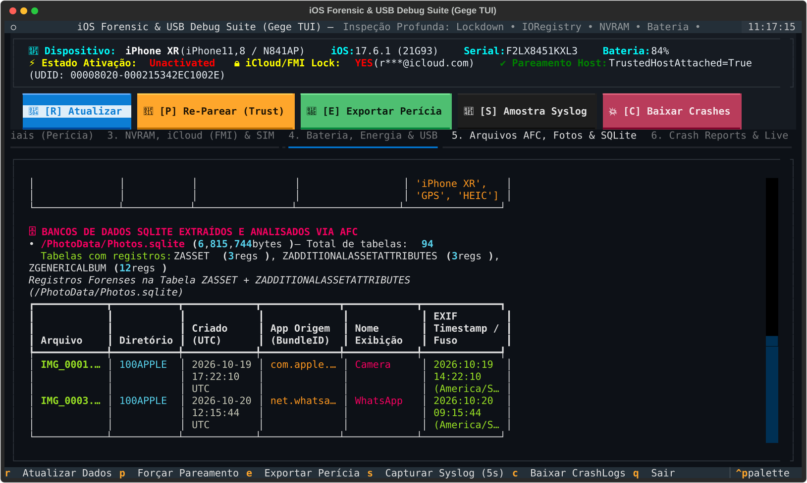

# 📱 iOS Forensics & USB Debug TUI Suite (`ios_forensics`)

[](https://github.com/RLuf/ios_fosensics/actions/workflows/windows-release.yml)
[](https://github.com/RLuf/ios_fosensics/actions/workflows/ai-code-review.yml)
[](https://github.com/RLuf/ios_fosensics/releases)
[](LICENSE)

🌐 **Idioma / Language:** **[🇧🇷 Português](#-português--suíte-tui-de-perícia-forense-e-debug-usb-ios)** | **[🇺🇸 English](#-english--ios-forensics--usb-debug-tui-suite)** | 📚 **[Documentação Completa (`./docs/`)](docs/INDEX.md)**

---

## 📸 Capturas de Tela da Interface TUI / TUI Screenshots

### 1. Resumo Geral & Pareamento Lockdown (`Tab 1 — Overview & Lockdown Pairing`)


<details>
<summary><b>🔎 Clique para ver as demais abas da TUI (Hardware/IORegistry, NVRAM/iCloud/SIM, Bateria/USB e AFC/SQLite/EXIF) / Click to expand all TUI tabs</b></summary>

#### 2. Auditoria Forense de Componentes & Seriais (`Tab 2 — IORegistry Hardware Serials`)


#### 3. NVRAM Decodificada, Bloqueio iCloud (FMI) & Cache SIM (`Tab 3 — NVRAM, Find My & SIM Cache`)


#### 4. Telemetria Química da Bateria & Barramento USB (`Tab 4 — SmartBattery, GasGauge & USB`)


#### 5. Sistema de Arquivos AFC, Fotos EXIF & Bancos SQLite (`Tab 5 — AFC, DCIM EXIF & SQLite ZASSET`)


</details>

---

## 🇧🇷 Português — Suíte TUI de Perícia Forense e Debug USB iOS

**iOS Forensics & USB Debug TUI Suite (`ios_forensics`)** é uma ferramenta interativa de terminal (**Textual + Rich**) para **Perícia Forense Digital, Auditoria de Componentes Internos e Inspeção USB em aparelhos Apple iOS (iPhone / iPad)**, com suporte nativo para **Windows 10/11 (x64)**, **Linux** e **macOS**.

### ✨ Principais Capacidades Periciais (Sem necessidade de Jailbreak)

1. **Identificação e Pareamento Lockdown (`lockdownd` / `usbmuxd`)**:
   - Extrai `UDID`, `ECID` (hexadecimal de 64 bits), versão do iOS, firmware `iBoot`, `ActivationState`, `PasswordProtected`, fuso horário e relógio interno.
   - Analisa os registros de pareamento em `C:\ProgramData\Apple\Lockdown` (Windows) ou `/var/lib/lockdown` (Linux).
2. **Auditoria Forense de Peças e Seriais (`IORegistry`)**:
   - Consulta diretamente os microcontroladores internos (`product`, `AppleSmartBattery`, `tristar`, `isp`, `lcd`) e decodifica a fábrica, ano e semana de fabricação de seriais de 12 e 17 caracteres: Placa Lógica (`MLBSerialNumber`), Bateria, Painel Display/Touch (`raw-panel-serial-number`), Cover Glass (`coverglass-serial-number`), FaceID Flood Illuminator (`rosaline-serial-num`) e Chip USB Tristar/Hydra.
3. **Decodificação de NVRAM, iCloud Lock (Find My) e Histórico de Chip SIM**:
   - Decodifica variáveis Base64 e `bplist00` da NVRAM (`fm-activation-locked`, `fm-account-masked`, `fm-spstatus`, `fm-spkeys`).
   - Recupera do cache (`CarrierBundleInfoArray`) o **ICCID**, **IMSI** e operadora (`MCC/MNC`) do último SIM Card inserido, além de `IMEI 1`, `IMEI 2 (eSIM)` e `MEID`.
4. **Telemetria Química de Bateria (`AppleSmartBattery` & `GasGauge`)**:
   - Contagem de ciclos, capacidade nominal vs. projeto, tensão (mV), corrente instantânea (mA), temperatura da célula (°C), desconexões registradas e potência USB negociada.
5. **Extração AFC, Metadados EXIF e Bancos SQLite (`Photos.sqlite` / `ZASSET`)**:
   - Varre `/DCIM/100APPLE`, extrai datas e tags EXIF de fotos e inspeciona tabelas SQLite (`ZASSET` + `ZADDITIONALASSETATTRIBUTES`) revelando datas UTC de criação e o aplicativo de origem (`com.apple.camera`, `net.whatsapp.WhatsApp`, etc.).
6. **Exportação Pericial Completa com Cadeia de Custódia (`manifest_sha256.txt`)**:
   - Pressionando **`[E]`** (ou executando `--cli-export`), exporta `forensic_report.json`, fotos do `DCIM`, bancos `SQLite`, plists de `Lockdown` e gera automaticamente o manifesto criptográfico **`manifest_sha256.txt`**.

### 🪟 Instalador e Pacote para Windows 10/11 (x64)

Na aba [**Releases**](https://github.com/RLuf/ios_fosensics/releases), cada versão disponibiliza:

- **`iOS_Forensics_Setup_v1.2.0_x64.exe`**: Instalador completo (**Inno Setup**) assinado digitalmente com **Authenticode SHA-256**, incluindo:
  - Executável nativo otimizado `ios_forensics.exe` (**PyInstaller**, sem UPX para abertura instantânea e evitar heurísticas de antivírus).
  - Binários `libimobiledevice` + `usbmuxd` Win64 (`ideviceinfo.exe`, `idevicepair.exe`, `idevicediagnostics.exe`, `idevicesyslog.exe`, `idevicecrashreport.exe`, `afcclient.exe`, `usbmuxd.exe` e DLLs) em `bin/`.
  - Script automatizado com auto-elevação UAC [`install_drivers.ps1`](packaging/windows/install_drivers.ps1) que instala os drivers USB Apple (`VID_05AC`) via `pnputil.exe`, inicia o `Apple Mobile Device Service` (AMDS), gera logs persistentes em `%ProgramData%\iOS_Forensics\logs\` e importa o certificado Authenticode.
- **`iOS_Forensics_Portable_v1.2.0_x64.zip`**: Edição portátil pronta para uso em pen-drives de resposta a incidentes.
- **`RLuf_iOS_Forensics_CodeSign.cer`** & **`SHA256SUMS.txt`**: Certificado público de assinatura de código e manifesto de hashes SHA-256.

### 🚀 Execução Rápida (PT-BR)

```bash
# No Windows (após instalar ou extrair o ZIP portátil):
ios_forensics.exe                 # Abertura imediata (<100ms) com workers assíncronos
ios_forensics.exe --no-auto-collect # Abre a TUI sem disparar varredura imediata
ios_forensics.exe --cli-export    # Exportação pericial em modo linha de comando

# Via Python (Linux / Windows / macOS):
pip install -r requirements.txt
python3 ios_forensics_tui.py
python3 ios_forensics_tui.py --no-auto-collect
python3 ios_forensics_tui.py --cli-export
```

### 📚 Documentação Completa (PT-BR & EN)

- 📖 **[Índice da Documentação (`docs/INDEX.md`)](docs/INDEX.md)**
- 🧭 **[Guia de Uso e Operação Pericial (`docs/USAGE_GUIDE.md`)](docs/USAGE_GUIDE.md)**
- 🔬 **[Arquitetura das 6 Camadas Forenses (`docs/FORENSIC_ARCHITECTURE.md`)](docs/FORENSIC_ARCHITECTURE.md)**
- 🪟 **[Instalador Windows, Drivers USB e Assinatura (`docs/WINDOWS_INSTALLER_AND_DRIVERS.md`)](docs/WINDOWS_INSTALLER_AND_DRIVERS.md)**
- 🤖 **[Relatório de Auditoria por IA — Jules, Codex & Gemini (`docs/AI_CODE_REVIEW.md`)](docs/AI_CODE_REVIEW.md)**
- 🛡️ **[Diretrizes de Agentes e Regra de Ouro (`AGENTS.md` / `AGENTES.md`)](AGENTS.md)**
- 📜 **[Histórico de Versões (`CHANGELOG.md`)](CHANGELOG.md)**

---

## 🇺🇸 English — iOS Forensics & USB Debug TUI Suite

**iOS Forensics & USB Debug TUI Suite (`ios_forensics`)** is an interactive terminal application (**Textual + Rich**) designed for **Digital Forensics, Hardware Component Authenticity Auditing, and Deep USB Inspection on Apple iOS devices (iPhone / iPad)** across **Windows 10/11 (x64)**, **Linux**, and **macOS**.

### ✨ Key Forensic Capabilities (No Jailbreak Required)

1. **Device Overview & Lockdown Pairing (`lockdownd` / `usbmuxd`)**:
   - Extracts `UDID`, 64-bit `ECID` (hex), iOS & `iBoot` versions, `ActivationState`, `PasswordProtected`, timezone, and internal RTC clock.
   - Parses Lockdown pairing plists in `C:\ProgramData\Apple\Lockdown` (Windows) or `/var/lib/lockdown` (Linux).
2. **Component Serial Authenticity Audit (`IORegistry`)**:
   - Queries internal hardware nodes (`product`, `AppleSmartBattery`, `tristar`, `isp`, `lcd`) and decodes factory ID, manufacturing year, and week from 12-char and 17-char Apple serials (`MLBSerialNumber`, Battery, `raw-panel-serial-number`, `coverglass-serial-number`, FaceID `rosaline-serial-num`, and Tristar/Hydra USB IC).
3. **Decoded NVRAM, iCloud Activation Lock (Find My) & Cached SIM History**:
   - Automatically decodes Base64 and binary plist (`bplist00`) NVRAM variables (`fm-activation-locked`, `fm-account-masked`, `fm-spstatus`, `fm-spkeys`).
   - Recovers cached SIM metadata (`ICCID`, `IMSI`, carrier `MCC/MNC`) even when no physical SIM card is currently inserted, along with dual `IMEI` and `MEID`.
4. **SmartBattery & GasGauge Telemetry**:
   - Cycle count, design vs. nominal capacity, health percentage, cell voltage (mV), instant current (mA), temperature (°C), cell disconnect count, and USB adapter wattage.
5. **AFC File System, EXIF Metadata & SQLite Databases (`Photos.sqlite` / `ZASSET`)**:
   - Scans `/DCIM/100APPLE`, extracts JPEG EXIF dates/tags, and queries SQLite databases (`ZASSET` + `ZADDITIONALASSETATTRIBUTES`) with safe identifier escaping and explicit UTC CoreData timestamps.
6. **Full Forensic Export & Chain of Custody (`manifest_sha256.txt`)**:
   - Pressing **`[E]`** (or passing `--cli-export`) exports `forensic_report.json`, `DCIM` photos, `SQLite` databases, `Lockdown` plists, and writes a complete SHA-256 custody manifest (`manifest_sha256.txt`).

### 🪟 Windows 10/11 (x64) Installer, Drivers & Authenticode Signing

Every GitHub [**Release**](https://github.com/RLuf/ios_fosensics/releases) ships with:

- **`iOS_Forensics_Setup_v1.2.0_x64.exe`**: Signed **Inno Setup** installer bundling `ios_forensics.exe` (**PyInstaller**, UPX disabled for zero decompression latency), native Win64 `libimobiledevice` + `usbmuxd` binaries (`bin/`), automated Apple USB Driver provisioning with UAC auto-elevation and persistent logging via `pnputil.exe` ([`install_drivers.ps1`](packaging/windows/install_drivers.ps1)), and **Authenticode SHA-256** code signing ([`sign_artifacts.ps1`](packaging/windows/sign_artifacts.ps1)).
- **`iOS_Forensics_Portable_v1.2.0_x64.zip`**: Standalone portable bundle.
- **`RLuf_iOS_Forensics_CodeSign.cer`** & **`SHA256SUMS.txt`**: Public Authenticode certificate and SHA-256 checksums.

### 🚀 Quick Start (EN)

```bash
# Windows (Installer or Portable ZIP):
ios_forensics.exe                 # Instant startup (<100ms) with async workers
ios_forensics.exe --no-auto-collect # Open TUI without triggering an immediate scan
ios_forensics.exe --cli-export    # Command-line forensic report and package export

# Python (Linux / Windows / macOS):
pip install -r requirements.txt
python3 ios_forensics_tui.py
python3 ios_forensics_tui.py --no-auto-collect
python3 ios_forensics_tui.py --cli-export
```

### 🤖 AI Code Review & Audit Credits

Audited and verified with automated workflows and multi-agent code review by **Jules** (`@jules` / `@google-labs-jules` — [PR #3](https://github.com/RLuf/ios_fosensics/pull/3)), **Codex** (`@codex`), and **Gemini** (`@gemini-code-assist`). See [`docs/AI_CODE_REVIEW.md`](docs/AI_CODE_REVIEW.md) for full details.
