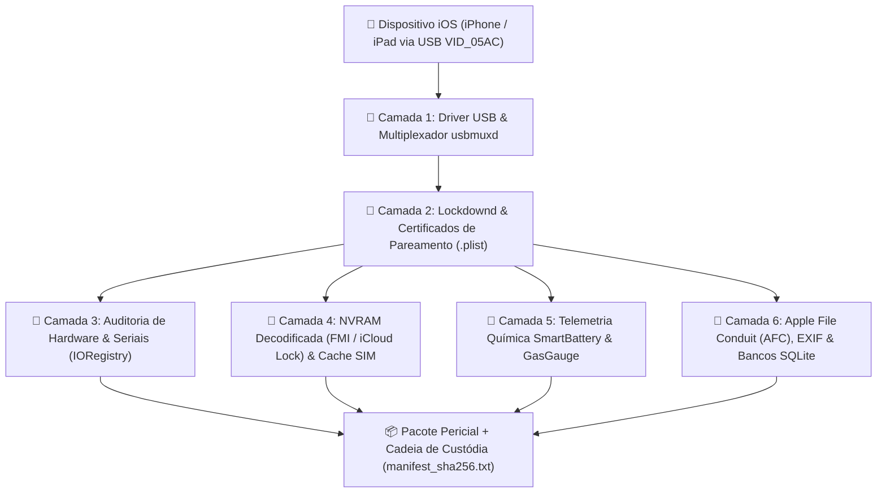

# 🔬 Arquitetura Forense e Camadas de Extração / Forensic Architecture

**🇧🇷 Português** | **[🇺🇸 English](#-english--forensic-architecture--extraction-layers)**

---

## 🇧🇷 Português — Arquitetura Técnica das 6 Camadas Forenses

O coletor [`IOSForensicCollector`](../ios_forensics_tui.py) opera em 6 camadas complementares sobre o protocolo USB Apple (`usbmuxd` / `lockdownd`), permitindo extrair o máximo de evidências mesmo em aparelhos bloqueados ou na tela de ativação (`Unactivated`) sem necessidade de Jailbreak.

### 1. Pareamento Automático em Estado `Unactivated`
Quando um iPhone recém-restaurado encontra-se em `ActivationState = Unactivated` e `PasswordProtected = False`, o daemon `lockdownd` permite a validação imediata do par criptográfico (`idevicepair validate`) sem exigir o popup *"Confiar Neste Computador"* na tela, gerando o registro `.plist` em:
- **Windows:** `C:\ProgramData\Apple\Lockdown\<UDID>.plist`
- **Linux:** `/var/lib/lockdown/<UDID>.plist`
- **macOS:** `/var/db/lockdown/<UDID>.plist`

### 2. Auditoria de Originalidade de Peças (`IORegistry`)
Por meio de `idevicediagnostics ioregentry <node>`, a suíte consulta diretamente os nós da árvore `IORegistry` do kernel XNU:
- `product`: extrai `coverglass-serial-number` (vidro frontal), `raw-panel-serial-number` (display/touch), `rosaline-serial-num` (projetor Flood Illuminator do FaceID) e `ambient-light-sensor-serial-num`.
- `AppleSmartBattery`: extrai o serial gravado no controlador Texas Instruments da bateria (`Serial`).
- `tristar`: identifica o controlador de carga/USB (`esn` e `compatible`).
- A função `decode_apple_serial_date()` decodifica tanto seriais Apple de 12 caracteres quanto seriais de componentes de 17 caracteres (código de fábrica de 3 letras + ano + semana de fabricação), revelando imediatamente se a tela, bateria ou placa lógica foram substituídas.

### 3. Decodificação de NVRAM e Bloqueio iCloud (Find My / Activation Lock)
O dicionário `NonVolatileRAM` retornado pelo `lockdownd` armazena valores codificados em Base64 que frequentemente encapsulam estruturas **Binary Plist (`bplist00`)**:
- `fm-activation-locked`: confirma se o bloqueio de ativação iCloud está ativo no iBoot/NVRAM.
- `fm-account-masked`: exibe a máscara do Apple ID vinculado ao aparelho.
- `fm-spstatus` e `fm-spkeys`: revelam o estado e as chaves públicas criptográficas da rede **Find My Offline (Search Party)**.

### 4. Histórico do Último SIM Card (`CarrierBundleInfoArray`)
Mesmo quando a gaveta SIM está sem chip físico (`kCTSIMSupportSIMStatusNotInserted`), o iOS mantém em cache os metadados do último chip utilizado:
- `IntegratedCircuitCardIdentity` (**ICCID** completo do chip SIM)
- `InternationalMobileSubscriberIdentity` (**IMSI** do assinante)
- `MCC` / `MNC` e `CFBundleIdentifier` da operadora (ex.: `724` / `06` — Vivo Brasil).

### 5. Extração AFC, Fotos DCIM, EXIF e SQLite (`ZASSET`)
Quando o serviço `com.apple.afc` está acessível:
- Lista diretórios da partição de mídia (`/DCIM/100APPLE`, `/PhotoData`, `/Downloads`, `/MediaAnalysis`).
- Baixa cabeçalhos/arquivos de `/DCIM/100APPLE` e extrai timestamps e tags EXIF (`parse_jpeg_exif_basic`).
- Baixa os bancos SQLite (`Photos.sqlite`, `downloads.28.sqlitedb`, `mediaanalysis.db`), escapa os nomes de tabelas com segurança (`safe_t = t.replace('"', '""')`), contabiliza registros e executa `JOIN` entre `ZASSET` e `ZADDITIONALASSETATTRIBUTES`, convertendo timestamps CoreData (segundos desde `2001-01-01 00:00:00 UTC`) para datas legíveis e identificando o aplicativo de origem (`ZIMPORTEDBYBUNDLEIDENTIFIER`, como Câmera nativa ou WhatsApp).

### 6. Cadeia de Custódia (`manifest_sha256.txt`)
Ao exportar a perícia (`export_full_forensic_package`), todos os artefatos salvos no diretório de saída são lidos em blocos de 64 KB para gerar o arquivo `manifest_sha256.txt`, assegurando integridade probatória auditável.

---

## 🇺🇸 English — Forensic Architecture & Extraction Layers

[`IOSForensicCollector`](../ios_forensics_tui.py) inspects 6 distinct layers over USB (`usbmuxd` / `lockdownd`) without requiring a jailbreak:

1. **USB & Multiplexer Layer**: Queries Windows PnP (`Get-PnpDevice` for `VID_05AC` and `Apple Mobile Device Service` / `usbmuxd`) or Linux `lsusb`/`systemctl`/`dmesg`.
2. **Lockdown & Pairing Layer**: Validates host trust (`idevicepair validate`) and parses `.plist` pairing records (`HostID`, `SystemBUID`, `WiFiMACAddress`, `EscrowBag`).
3. **Hardware Component Authenticity (`IORegistry`)**: Queries XNU `IORegistry` nodes (`product`, `AppleSmartBattery`, `tristar`, `isp`, `lcd`) and decodes 12-char and 17-char Apple factory/year/week serial numbers to detect aftermarket part replacements.
4. **NVRAM (`bplist00` / Base64) & Cached SIM Forensics**: Decodes `fm-activation-locked`, `fm-account-masked`, `fm-spstatus`, `fm-spkeys`, and extracts cached SIM `ICCID`, `IMSI`, `MCC/MNC`, and dual `IMEI` identifiers.
5. **SmartBattery & GasGauge Telemetry**: Extracts cycle count, design vs. nominal capacity, cell voltage (mV), instant amperage (mA), cell temperature (°C), disconnect counters, and USB adapter wattage.
6. **AFC, EXIF & SQLite (`ZASSET`) + Chain of Custody (`manifest_sha256.txt`)**: Pulls media files and SQLite databases over Apple File Conduit, parses `ZASSET` CoreData timestamps in explicit UTC, and writes a complete SHA-256 hash manifest (`manifest_sha256.txt`).
