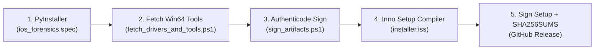

# 🪟 Instalador Windows, Drivers USB e Assinatura Digital / Windows Installer, Drivers & Code Signing

**🇧🇷 Português** | **[🇺🇸 English](#-english--windows-installer-drivers--code-signing)**

---

## 🇧🇷 Português — Arquitetura do Empacotamento Windows (x64)

O pipeline [`.github/workflows/windows-release.yml`](../.github/workflows/windows-release.yml) automatiza a geração do instalador completo para **Windows 10/11 (x64)** em 5 estágios:

### 1. Compilação do Executável (`packaging/windows/ios_forensics.spec`)
- Empacota [`ios_forensics_tui.py`](../ios_forensics_tui.py) juntamente com todos os módulos e folhas de estilo do `textual` e `rich`.
- Incorpora metadados PE do Windows ([`version_info.txt`](../packaging/windows/version_info.txt)): nome do produto, versão `1.1.0.0`, empresa e copyright.

### 2. Binários `libimobiledevice` + `usbmuxd` Win64 (`fetch_drivers_and_tools.ps1`)
- Baixa automaticamente a distribuição oficial `libimobiledevice` Win64 (`ideviceinfo.exe`, `idevicepair.exe`, `idevicediagnostics.exe`, `idevicesyslog.exe`, `idevicecrashreport.exe`, `idevice_id.exe`, `afcclient.exe`, `usbmuxd.exe` e todas as DLLs nativas) e organiza em `build/bundle/bin/`.
- Em tempo de execução, `configure_runtime_environment()` injeta automaticamente `%ProgramFiles%\iOS_Forensics\bin` e o diretório local `bin/` no início da variável `PATH`.

### 3. Provisionamento de Drivers USB Apple (`install_drivers.ps1`)
Executado automaticamente pelo instalador (ou manualmente pelo atalho *"Reparar Drivers USB Apple & usbmuxd"* no Menu Iniciar):
1. Importa o certificado público `RLuf_iOS_Forensics_CodeSign.cer` nos repositórios `Cert:\LocalMachine\TrustedPublisher` e `Cert:\LocalMachine\Root`.
2. Instala arquivos `.inf` de drivers USB Apple (`VID_05AC`) via `pnputil.exe /add-driver ... /install`.
3. Inicia o `Apple Mobile Device Service` (se o iTunes/Apple Devices estiver instalado) ou registra e inicia o serviço `usbmuxd` nativo via `sc.exe`.
4. Garante a criação do diretório `C:\ProgramData\Apple\Lockdown`.

### 4. Assinatura Digital Authenticode SHA-256 (`sign_artifacts.ps1`)
- Suporta dois modos de operação no CI/CD:
  - **Certificado Corporativo / EV / OV (via GitHub Secrets):** Se os secrets `WINDOWS_PFX_BASE64` e `WINDOWS_PFX_PASSWORD` estiverem configurados no repositório, utiliza o certificado PFX fornecido.
  - **Certificado Authenticode Auto-Gerado (Fallback Padrão):** Gera um certificado X.509 de assinatura de código (`CN=RLuf iOS Forensics Open Source`, RSA 2048 bits, SHA-256), exporta a chave pública `RLuf_iOS_Forensics_CodeSign.cer` e assina tanto `ios_forensics.exe` quanto `iOS_Forensics_Setup_v1.1.0_x64.exe` usando `signtool.exe` do Windows 10/11 SDK com carimbo de tempo RFC3161 (`http://timestamp.digicert.com`).

---

## 🇺🇸 English — Windows Installer, Drivers & Code Signing

The [`.github/workflows/windows-release.yml`](../.github/workflows/windows-release.yml) workflow builds, signs, and publishes a turnkey Windows 10/11 (x64) release:

1. **Standalone Binary (`PyInstaller`)**: Builds `ios_forensics.exe` using [`ios_forensics.spec`](../packaging/windows/ios_forensics.spec) and embeds Windows PE version resources ([`version_info.txt`](../packaging/windows/version_info.txt)).
2. **Bundled `libimobiledevice` & `usbmuxd` Win64 Tools (`fetch_drivers_and_tools.ps1`)**: Fetches and bundles all required native Win64 CLI tools and DLLs into `bin/`.
3. **Automated USB Driver & Service Setup (`install_drivers.ps1`)**: Uses `pnputil.exe` to install Apple Mobile Device USB `.inf` drivers, configures the `Apple Mobile Device Service` or `usbmuxd` Windows service, and initializes `C:\ProgramData\Apple\Lockdown`.
4. **Authenticode SHA-256 Signing (`sign_artifacts.ps1`)**: Signs both `ios_forensics.exe` and the Inno Setup installer (`iOS_Forensics_Setup_v1.1.0_x64.exe`) with `signtool.exe` and DigiCert's RFC3161 timestamp server, using either `WINDOWS_PFX_BASE64` / `WINDOWS_PFX_PASSWORD` secrets or an automatically generated Authenticode certificate exported as `RLuf_iOS_Forensics_CodeSign.cer`.
