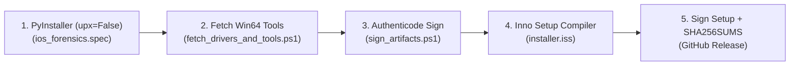

# 🪟 Instalador Windows, Drivers USB e Assinatura Digital / Windows Installer, Drivers & Code Signing

**🇧🇷 Português** | **[🇺🇸 English](#-english--windows-installer-drivers--code-signing)**

---

## 🇧🇷 Português — Arquitetura do Empacotamento Windows (x64)

O pipeline [`.github/workflows/windows-release.yml`](../.github/workflows/windows-release.yml) automatiza a geração do instalador completo para **Windows 10/11 (x64)** em 5 estágios:

### 1. Compilação do Executável (`packaging/windows/ios_forensics.spec`)

- Empacota [`ios_forensics_tui.py`](../ios_forensics_tui.py) com dependências do `textual` e `rich`.
- **Desativação de UPX (`upx=False`)**: A compressão UPX foi desativada na v1.2.0 para eliminar o atraso de descompressão em memória na inicialização e prevenir falsos positivos ou bloqueios pelo Windows Defender.
- Incorpora metadados PE do Windows ([`version_info.txt`](../packaging/windows/version_info.txt)): nome do produto, versão `1.2.0.0`, empresa e copyright.

### 2. Binários `libimobiledevice` + `usbmuxd` Win64 (`fetch_drivers_and_tools.ps1`)

- Baixa automaticamente a distribuição oficial `libimobiledevice` Win64 (`ideviceinfo.exe`, `idevicepair.exe`, `idevicediagnostics.exe`, `idevicesyslog.exe`, `idevicecrashreport.exe`, `idevice_id.exe`, `afcclient.exe`, `usbmuxd.exe` e DLLs) e organiza em `build/bundle/bin/`.
- Em tempo de execução, `configure_runtime_environment()` injeta automaticamente `%ProgramFiles%\iOS_Forensics\bin` e o diretório local `bin/` no início da variável `PATH`.

### 3. Provisionamento de Drivers USB Apple e Auto-Elevação UAC (`install_drivers.ps1`)

Executado automaticamente pelo instalador ou pelo atalho *"Reparar Drivers USB Apple"* no Menu Iniciar:

1. **Auto-Elevação UAC Obrigatória**: Verifica se o processo atual possui privilégios administrativos (`Test-IsAdmin`). Caso contrário, auto-relança via `Start-Process powershell.exe -Verb RunAs` solicitando consentimento UAC.
2. **Logs Persistentes de Instalação**: Grava transcript completo da execução em `%ProgramData%\iOS_Forensics\logs\install_drivers_<timestamp>.log`.
3. **Instalação e Rescaneamento PnP (`pnputil.exe`)**: Instala drivers `.inf` para `VID_05AC` e valida códigos de retorno do Windows (0 = Sucesso, 259 = Sem alterações, 3010 = Reinício pendente), executando `pnputil.exe /scan-devices` em seguida.
4. **Remoção de Serviço Inválido e Suporte AMDS**: Remove serviços órfãos criados incorretamente via `sc.exe create usbmuxd` (o binário de console do usbmuxd não é um Windows Service e causava Erro 1053 com 30s de travamento). Inicia o serviço padrão da Apple (**Apple Mobile Device Service / AMDS**).
5. **Suporte a Winget (`-InstallAppleSupport`)**: Parâmetro opcional que instala automaticamente o aplicativo *Apple Devices* via `winget` caso os drivers nativos não estejam presentes no sistema.
6. **Cadeia de Certificados**: Importa `RLuf_iOS_Forensics_CodeSign.cer` nos repositórios `TrustedPublisher` e `Root`.

### 4. Assinatura Digital Authenticode SHA-256 (`sign_artifacts.ps1`)

- Suporta dois modos de operação no CI/CD:
  - **Certificado Corporativo / EV / OV (via GitHub Secrets):** Se os secrets `WINDOWS_PFX_BASE64` e `WINDOWS_PFX_PASSWORD` estiverem configurados no repositório, utiliza o certificado PFX fornecido.
  - **Certificado Authenticode Auto-Gerado (Fallback Padrão):** Gera um certificado X.509 de assinatura de código (`CN=RLuf iOS Forensics Open Source`, RSA 2048 bits, SHA-256), exporta a chave pública `RLuf_iOS_Forensics_CodeSign.cer` e assina tanto `ios_forensics.exe` quanto `iOS_Forensics_Setup_v1.2.0_x64.exe` usando `signtool.exe` do Windows 10/11 SDK com carimbo de tempo RFC3161 (`http://timestamp.digicert.com`).

---

## 🇺🇸 English — Windows Installer, Drivers & Code Signing

The [`.github/workflows/windows-release.yml`](../.github/workflows/windows-release.yml) workflow builds, signs, and publishes a turnkey Windows 10/11 (x64) release:

1. **Standalone Binary (`PyInstaller`)**: Builds `ios_forensics.exe` with `upx=False` to eliminate startup decompression latency and Windows Defender scan lag. Embeds Windows PE version resources (`1.2.0.0`).
2. **Bundled `libimobiledevice` & `usbmuxd` Win64 Tools (`fetch_drivers_and_tools.ps1`)**: Fetches and bundles all required native Win64 CLI tools and DLLs into `bin/`.
3. **Automated USB Driver Setup with UAC Self-Elevation (`install_drivers.ps1`)**:
   - Detects administrative rights and elevates via UAC (`Start-Process powershell.exe -Verb RunAs`).
   - Writes persistent execution transcripts to `%ProgramData%\iOS_Forensics\logs\install_drivers_<timestamp>.log`.
   - Uses `pnputil.exe` to install Apple Mobile Device USB `.inf` drivers and forces device rescanning (`/scan-devices`).
   - Removed broken `sc.exe create usbmuxd` (Windows SCM Error 1053) in favor of the standard Apple Mobile Device Service (AMDS).
   - Supports optional `-InstallAppleSupport` flag to install Apple Devices / iTunes via `winget`.
4. **Authenticode SHA-256 Signing (`sign_artifacts.ps1`)**: Signs both `ios_forensics.exe` and `iOS_Forensics_Setup_v1.2.0_x64.exe` with `signtool.exe` and DigiCert RFC3161 timestamping.
